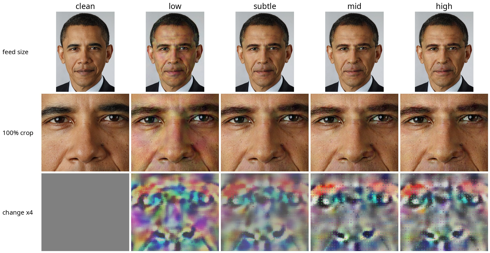
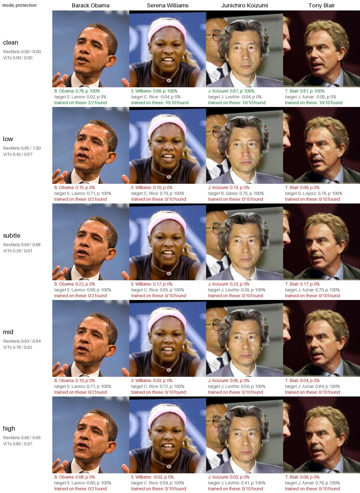
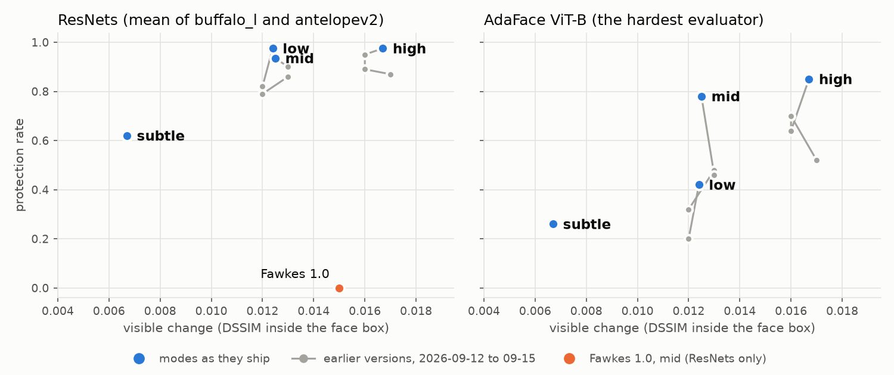

Fawkes
------

Fawkes is a privacy protection system developed by researchers at [SANDLab](https://sandlab.cs.uchicago.edu/),
University of Chicago. It adds small, hard-to-see changes ("cloaks") to your photos so that facial
recognition models trained on them learn the wrong face. For the original project see the
[project webpage](https://sandlab.cs.uchicago.edu/fawkes/) and the paper
"[Fawkes: Protecting Personal Privacy against Unauthorized Deep Learning Models](https://www.shawnshan.com/files/publication/fawkes.pdf)"
(USENIX Security 2020).

This fork is a rewrite of the cloaking pipeline (version 2):

- cloaks push your face toward a **target person you choose**, the method described in the paper,
  instead of just away from itself;
- the perturbation is optimised against an **ensemble of modern face recognisers** (ArcFace IR-100,
  AdaFace IR-101, LVFace ViT-B) through the same **landmark alignment** those recognisers use;
- the optimisation is robust to blur, resizing and JPEG re-encoding;
- protection is **measured** on a public dataset against recognisers that were *not* used to build the
  cloaks (see [Evaluation](#evaluation));
- runs on PyTorch (CPU is fine), TensorFlow is gone.

The reasons behind these choices, with sources, are in [docs/DECISIONS.md](docs/DECISIONS.md).

### Results

The **protection rate** is the fraction of a person's clean photos that a face classifier gets wrong
after it was trained on their cloaked photos. The classifier uses one of five recognisers, none of
which was used to build the cloaks: two ResNets (buffalo_l, antelopev2) and three transformers
(AdaFace ViT-B, LVFace-T, ViT-L WebFace42M). Numbers are on LFW, averaged over two splits of 10
protected identities (see [Evaluation](#evaluation)).

| mode | protection, ResNets | protection, transformers | after JPEG 75, weakest recogniser | visible change (DSSIM, face) | apparent ageing (MiVOLO, author's photos) |
|---|---|---|---|---|---|
| Fawkes 1.0, mid | 0.00 / 0.00 | - | 0.00 | 0.015 | - |
| low | 0.95 / 1.00 | 0.42 / 0.57 / 0.49 | 0.45 | 0.012 | not measured |
| subtle | 0.56 / 0.68 | 0.26 / 0.61 / 0.60 | 0.22 | 0.007 | +5.8 years |
| mid | 0.93 / 0.94 | 0.78 / 0.92 / 0.88 | 0.75 | 0.012 | +6.7 years |
| high | 0.96 / 0.99 | 0.85 / 0.97 / 0.95 | 0.79 | 0.017 | +8.5 years |

`mid` and `high` defeat the classifier for most people on every recogniser, and the original Fawkes
for none. `low` uses only the two ResNet surrogates: it protects as well as `high` on the ResNets
and half as well on the transformers, and without the colour and age penalties it tints the skin.
`subtle` is hard to see at feed size and protects about half as well as `mid`. All modes still make
faces look a few years older; see [Known limitations](#known-limitations).



The same photo (Barack Obama's official portrait, 1280 pixels wide, from Wikimedia Commons) at feed
size, at 100 percent, and the change amplified four times. At feed size the cloaks are hard to tell
apart from the clean photo; at full size `mid` and `high` show darker brows and lines under the
eyes, `subtle` much less, and `low`, without the colour penalty, a reddish and greenish tint. Made
with `eval/closeup.py`.

Licence
-------
The code in this repository is released under the BSD-3-Clause licence (see [LICENSE](LICENSE));
it is a derivative of the original Fawkes by SANDLAB, University of Chicago, under the same licence.
The network definitions vendored in `fawkes/arch/` come from InsightFace and CVLface (MIT, notices
kept in the file headers).

That licence covers the code only. The pretrained detector and recogniser weights the tool downloads
from Hugging Face are **not** part of this repository and carry their own terms: every one of them is
licensed for non-commercial research use only (see [Model licences](#model-licences)). In practice
this means the tool as a whole may be used for personal privacy protection and academic research,
but not commercially, regardless of the code licence.

Usage
-----

```
fawkes -d ./imgs --mode subtle
```

or `python3 -m fawkes -d ./imgs -m subtle`. Without `--target-dir` Fawkes picks the target for you
(see [Choosing a target](#choosing-a-target)); that needs the target pool, built once with
`python -m fawkes.target_pool build` (requires the `eval` extra for LFW).

Every image in `./imgs` gets a `<name>_cloaked.png` next to it. Options:

* `-d`, `--directory`: the directory with images to protect.
* `-t`, `--target-dir`: a directory with a few photos of the person your cloaked photos should
  resemble to a recogniser (default: picked automatically). See [Choosing a target](#choosing-a-target).
* `--target-strategy`: `far` (default) or `near`, which of the matched pool identities the automatic
  target is.
* `-m`, `--mode`: `low`, `subtle`, `mid` (default) or `high`, the tradeoff between protection
  strength, visible change and run time:

  | mode | surrogates | steps | max pixel change | DSSIM budget | colour penalty | age penalty | s / face, A100 | s / face, 8-core CPU |
  |---|---|---|---|---|---|---|---|---|
  | low | AdaFace IR-101, ArcFace IR-100 | 60 | 16 | 0.012 | - | - | 0.4 | 18 |
  | subtle | + LVFace-B, LVFace-L, LVFace-S (transformers) | 120 | 12 | 0.006 | 30 | 1 | 2.7 | 55 |
  | mid | same five | 120 | 24 | 0.012 | 30 | 2 | 3.3 | 53 |
  | high | same five | 200 | 20 | 0.017 | 30 | 3 | 5.2 | 76 |

  `subtle` is for photos you want to post: at feed size the change is hard to see, and it protects
  less (see [Evaluation](#evaluation)). `mid` and `high` protect more and are visible as a slight
  change of the face's shading. The times are per extra face with the default batch size
  (`eval/time_modes.sh`, LFW photos, an A100 and 8 cores of a Cascade Lake Xeon); every run also
  spends 20 to 30 s on a GPU, and 3 to 90 s on a CPU, loading the models and picking the target.

  Every mode also penalises what is left of your own identity in the cloaked face
  (`--self-weight`, see [docs/DECISIONS.md](docs/DECISIONS.md#10-penalise-the-residual-similarity-to-the-own-face-not-only-the-distance-to-the-target)).
  All but `low` penalise the colour part of the cloak, which is what shows as reddish or
  yellowish patches on the skin, and spend the DSSIM budget on luma detail instead
  (`--chroma-weight`, [decision 12](docs/DECISIONS.md#12-penalise-the-colour-of-the-cloak-and-raise-the-luma-bound)).
  All but `low` also penalise the apparent ageing of the face: without it the cloak draws folds and
  lines under the eyes that make people look years older (`--age-weight`,
  [decision 13](docs/DECISIONS.md#13-a-matched-automatic-target-an-age-penalty-and-a-subtle-mode)).
  The penalty reduces this ageing but does not remove it (see
  [Known limitations](#known-limitations)).

* `--models`: comma-separated surrogate keys overriding the mode (`python -m fawkes.models list`).
* `--steps`, `--eps`, `--th`, `--no-eot`, `--self-weight`: override the mode's steps, pixel bound,
  DSSIM budget, robustness views and residual penalty.
* `--chroma-weight`: penalty on the colour (Cb/Cr) part of the cloak (30 in `subtle`, `mid` and
  `high`, 0 in `low`). Higher values leave less visible tint and, above about 30, less protection;
  `--chroma-eps` is a hard bound on the colour change instead (0-255 units, `0` for a grey cloak),
  which costs more protection for the same tint (rounds 8 to 10 in [eval/RESULTS.md](eval/RESULTS.md)).
* `--batch-size`: faces optimised together (default 8; larger batches are faster per face).
* `--threads`: CPU threads for PyTorch.
* `--no-align`: the inputs are already 112x112 aligned faces; skip detection.
* `--format`: `png` (default) or `jpg`.
* `--debug`: print per-face statistics.



Each column is one person (Barack Obama from Wikimedia Commons, and three people from
[LFW](https://vis-www.cs.umass.edu/lfw/)), and each row is a mode. Every tile is one of the three
photos that person "posts", cloaked in that row's mode with the automatic target. The row labels give
the mode's protection rate from [Evaluation](#evaluation) on the two ResNet recognisers (buffalo_l /
antelopev2) and two of the transformers (AdaFace ViT-B / LVFace-T).

The lines under a tile are the output of a simple face classifier: buffalo_l embeddings, one reference
per identity (the mean embedding of its photos), and a cosine threshold of 0.35.
- *first line*: the posted photo's cosine similarity to the person's reference, which is built from
  other, clean photos of them, and the probability the classifier gives the person. The probability
  is a nearest-reference classifier over all ten people and targets in the figure, softmax(64 ×
  cosine); 64 is the scale ArcFace-type recognisers are trained with.
- *target*: the same for the target Fawkes picked, with the target's reference built from its LFW
  photos.
- *trained on these*: how many of the person's clean photos match a reference built from the row's
  three posted photos, as a scraper would build it. This is the protection Fawkes aims for.

In every cloaked row the posted photo is classified as the target with near certainty, and the scraper's
reference finds none of the real photos. This setting is easy for the cloak: the scraper sees only
cloaked photos, the classifier is a plain centroid, and the target's reference is built from the same
photos the cloak aimed at. With a trained classifier and other recognisers the protection is partial,
lowest in `subtle`. The cloak can also borrow a feature of the target: Tony Blair gets a faint
moustache from José María Aznar. Made with `eval/illustrate.py`.

### Choosing a target

A recogniser trained on your cloaked photos should learn the target's face, not yours.

**Automatic (default).** Fawkes groups the faces in your photos into people and picks a target for
each from a pool of about 420 public identities (LFW): the same apparent sex, a similar age and skin
tone, and, among those, the face least like yours (`--target-strategy far`). Differences in age, sex
or skin tone cost budget without changing identity: they are what made earlier cloaks look older or
tinted. A matched target also protects better (rounds 11 to 16 in [eval/RESULTS.md](eval/RESULTS.md)).
A person Fawkes has cloaked before keeps their target in later runs, so every photo of you pushes
toward the same false identity (remembered in `fawkes/model/target_pool/assignments.json`; delete it
to start over).

**Your own target** (`--target-dir`). All of your photos are pushed toward the same target, so use
the same directory every time; the embedding is cached in `<target-dir>/fawkes_target.npz`.

- Use 3 to 10 photos of one person, each with exactly one clearly visible face. Photos with zero or
  several faces are skipped.
- Pick someone of your sex and roughly your age and skin tone who otherwise looks unlike you; a
  target much older than you makes the cloak draw age.
- Public figures work fine; their real photos are labelled as them, not as you.

### Tips

- Run time on an 8-core CPU without a GPU is about 20 s per face in `low` and about a minute per
  face in the other modes, plus up to a minute and a half to load the models; cloaking many photos
  in one run is faster per photo. A CUDA GPU is used
  automatically when PyTorch finds one (install with the `cu128` extra).
- Most of your published photos need to be cloaked for the protection to work; a recogniser trained
  on mostly clean photos of you learns your real face regardless.
- Cloaks survive JPEG re-encoding by design, but do not resize or filter the output more than a
  social network would.

### Known limitations

- **Future and adaptive recognisers.** Cloaks are fixed once you publish a photo, but recognisers
  keep improving. Radiya-Dixit et al. ([ICLR 2022](https://arxiv.org/abs/2106.14851)) showed that a
  model trained *after* a cloaking tool is released, or trained specifically against it, can defeat
  any such tool, including the original Fawkes. The evaluation measures transfer to strong
  recognisers of today that were not used to build the cloaks. It does not, and cannot, promise
  protection against future or adaptive models.
- **Cloaked faces look older.** The age penalty is optimised against one age model (genderage), which
  then reads the cloaked faces as younger. An age model the cloak never saw (MiVOLO v2) still reads
  the author's full-resolution photos as 5.8 / 6.7 / 8.5 years older in `subtle` / `mid` / `high`
  (10 to 15 years for the earlier cloaks without the penalty). On the small LFW faces the mean
  shift is near zero, but one face in ten gains 2 to 8 years.
- **`subtle` is weak against some recognisers.** It protects 0.26 on AdaFace ViT-B, and JPEG
  re-encoding takes the ViT-L WebFace42M rate from 0.60 to 0.34.
- **Results vary with who is protected.** The two identity splits differ by up to 0.36 in `subtle`,
  0.34 in `low`, 0.12 in `mid` and 0.06 in `high`, often more than the 0.06 sampling noise of each number.
- **AdaFace ViT-B is the hardest recogniser** in every mode, 0.07 to 0.3 below the
  next weakest.

Evaluation
----------

`eval/harness.py` downloads a subset of [LFW](http://vis-www.cs.umass.edu/lfw/), cloaks the training
photos of some identities (each toward its own target identity), trains a linear classifier on face
embeddings from **held-out** recognisers, and reports the **protection rate**: the fraction of clean
test photos of protected identities that the classifier gets wrong. 10 protected and 10 clean
identities, 10 training and 5 test photos each. The evaluators are the InsightFace packs most
deployments use (`buffalo_l`, a ResNet-50; `antelopev2`, a ResNet-100) and three vision transformers:
AdaFace ViT-B (WebFace4M), LVFace-T (Glint360K, the same family as three of the surrogates, so a
weaker test) and ViT-L (WebFace42M, shares no data with the surrogates). None of them is in the
surrogate ensemble.

The current modes, as they ship (automatic target), each the mean of two identity splits (rounds 17
and 19 in [eval/RESULTS.md](eval/RESULTS.md)):

| mode | buffalo_l | antelopev2 | AdaFace ViT-B | LVFace-T | ViT-L | DSSIM face | MiVOLO age shift on LFW, mean (90th percentile) |
|---|---|---|---|---|---|---|---|
| none | 0.00 | 0.00 | 0.00 | 0.00 | 0.00 | 0 | - |
| Fawkes 1.0 (TensorFlow), mid | 0.00 | 0.00 | - | - | - | 0.015 | - |
| Fawkes 1.0, mid, JPEG 75 | 0.00 | 0.00 | - | - | - | | | |
| low | 0.95 | 1.00 | 0.42 | 0.57 | 0.49 | 0.012 | +1.3 (+8 to +10) |
| low, JPEG 75 | 0.90 | 0.96 | 0.45 | 0.63 | 0.49 | | | |
| subtle | 0.56 | 0.68 | 0.26 | 0.61 | 0.60 | 0.007 | -1.0 (+2 to +6) |
| subtle, JPEG 75 | 0.49 | 0.59 | 0.22 | 0.50 | 0.34 | | | |
| mid | 0.93 | 0.94 | 0.78 | 0.92 | 0.88 | 0.012 | -1.1 (+3 to +7) |
| mid, JPEG 75 | 0.90 | 0.96 | 0.75 | 0.91 | 0.85 | | | |
| high | 0.96 | 0.99 | 0.85 | 0.97 | 0.95 | 0.017 | -0.7 (+4 to +8) |
| high, JPEG 75 | 0.95 | 0.99 | 0.79 | 0.97 | 0.92 | | | |

The original cloaks move the embeddings a little but every protected identity is still recognised.
Each current-mode number is 100 test photos (50 per split); the sampling noise is about 0.06, but
the two splits differ by more than that (see [Known limitations](#known-limitations)). The age
shift is measured by MiVOLO v2, an age model the cloak never saw; the 90th percentile is given per
split.

The table is for one threat model. Others:

| adversary | low | subtle | mid | high |
|---|---|---|---|---|
| trains on the cloaked photos, meets clean ones (the table above) | 0.42 to 1.00 | 0.26 to 0.68 | 0.78 to 0.94 | 0.85 to 0.99 |
| holds clean photos, meets a cloaked one (`--clean-gallery`) | 0.43 to 0.96 | 0.26 to 0.82 | 0.68 to 0.97 | 0.81 to 0.99 |
| 1:1 verification against a clean photo, cosine threshold 0.3: cloaked photos that fail to match | 0.95 to 1.00 | 0.86 to 0.97 | 0.99 to 1.00 | 1.00 |

Ranges are over the evaluators and are means of the two splits; AdaFace ViT-B is the low end
everywhere. The clean gallery uses the same cloaks (rounds 17 and 19): it is about as hard to beat
as the main threat model, a little easier on AdaFace ViT-B in `mid` and `high` (0.68 / 0.81 against
0.78 / 0.85).



How the modes got here: with three surrogates `mid` / `high` protected 0.32 / 0.52 on AdaFace
ViT-B; two more transformer surrogates took that to 0.48 / 0.70 (2026-09-13), a colour penalty
halved the reddish and yellowish patches on the skin at about equal protection (2026-09-15, decision
12), and the matched automatic target with the age penalty brought it to 0.78 / 0.85 (2026-09-25,
decision 13). `subtle` is the price of a cloak that is hard to see: on the author's photos every
setting that protected more than it also showed, and the strength at which nothing showed protected
nothing. The chart is made with `eval/plot_progress.py`. Every configuration tried is in
[eval/RESULTS.md](eval/RESULTS.md); the reasoning is in
[docs/DECISIONS.md](docs/DECISIONS.md). See [eval/README.md](eval/README.md) for the metrics and how
to run it.

Quick Installation
------------------

From a clone of this repository, with [uv](https://docs.astral.sh/uv/) (Python 3.12, locked
dependencies). PyTorch comes from one of two extras: `cpu` or `cu128` (CUDA 12.8 wheels):

```
uv sync --extra cpu          # or: uv sync --extra cu128
uv run fawkes -d ./imgs -t ./target --mode mid
```

Plain `pip install torch .` also works on Python 3.11 or newer. The face detector (17 MB) and the
surrogate weights (about 2.2 GB for `subtle`, `mid` and `high`, 500 MB for `low`) are downloaded
from Hugging Face on first use into `fawkes/model/`; `python -m fawkes.models download` prefetches
them.

### GPU

Optional. The cloaker uses CUDA when torch can see it, else the CPU. Install with the `cu128` extra
(pip users: a CUDA build of torch from [pytorch.org](https://pytorch.org/get-started/locally/)); force
a device with `--device` or `FAWKES_DEVICE`. Without internet at run time, prefetch the weights with
`python -m fawkes.models download` and set `HF_HUB_OFFLINE=1`.

Model licences
--------------

| key | model | source | licence |
|---|---|---|---|
| detector | SCRFD-10GF | [InsightFace](https://github.com/deepinsight/insightface) | non-commercial research |
| age penalty, target pool | genderage | [InsightFace](https://github.com/deepinsight/insightface) | non-commercial research |
| arcface_r100 | ArcFace IR-100, MS1MV3 | [InsightFace arcface_torch](https://github.com/deepinsight/insightface/tree/master/recognition/arcface_torch) | non-commercial research |
| adaface_ir101 | AdaFace IR-101, WebFace12M | [CVLface](https://github.com/mk-minchul/CVLface) | follows WebFace12M (research) |
| lvface_b | LVFace-B, Glint360K | [ByteDance LVFace](https://github.com/bytedance/LVFace) | non-commercial research |
| lvface_l | LVFace-L (ViT-L), Glint360K | [ByteDance LVFace](https://github.com/bytedance/LVFace) | non-commercial research |
| lvface_s | LVFace-S (ViT-S), Glint360K | [ByteDance LVFace](https://github.com/bytedance/LVFace) | non-commercial research |
| evaluators | w600k_r50, glintr100, AdaFace ViT-B, LVFace-T, ViT-L WebFace42M | InsightFace, CVLface, LVFace | research |
| held-out age judge (evaluation only) | MiVOLO v2 | [MiVOLO](https://huggingface.co/iitolstykh/mivolo_v2), ONNX export | Apache-2.0 |

Development
-----------

```
uv sync --extra cpu --extra eval
uv run pytest
```

Tests that need the surrogate weights run only when they are already in `fawkes/model/`. Tests that
need real photos run when `FAWKES_TEST_IMAGES` points to a directory of photos containing faces.

Academic Research Usage
-----------------------
To protect a class in a dataset, move that label's images to a separate directory and run Fawkes on
it with `--debug`. If the images are already cropped and aligned to the 112x112 ArcFace template,
add `--no-align`. Keep the evaluators in `eval/harness.py` disjoint from the surrogates you cloak
with, or the numbers mean nothing.

### Citation

```
@inproceedings{shan2020fawkes,
  title={Fawkes: Protecting Personal Privacy against Unauthorized Deep Learning Models},
  author={Shan, Shawn and Wenger, Emily and Zhang, Jiayun and Li, Huiying and Zheng, Haitao and Zhao, Ben Y},
  booktitle={Proc. of {USENIX} Security},
  year={2020}
}
```
